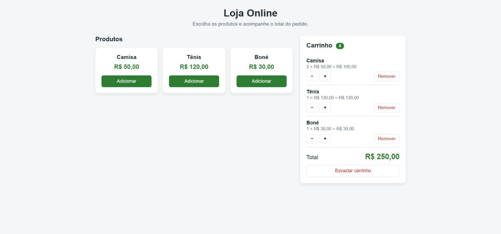

<h1 align="center">Mini sistema de pedidos</h1>

<p align="center">
  Simulação de uma loja online com carrinho de compras, feita com HTML, CSS e JavaScript puro.
</p>

<p align="center">
  <a href="https://bpontesleal-coder.github.io/mini-sistema-pedidos/"><strong>Testar online</strong></a>
</p>

<p align="center">
  
  
  
</p>



## Sobre o projeto

Meu primeiro projeto web. A proposta é reproduzir o fluxo básico de um e-commerce, da escolha do produto ao total do pedido, sem bibliotecas nem frameworks, para praticar lógica, manipulação do DOM e organização de código.

## Funcionalidades

- Listagem de produtos com preço em reais (`R$ 50,00`)
- Carrinho que soma a quantidade quando o mesmo produto é adicionado de novo
- Botões para aumentar, diminuir e remover cada item, e para esvaziar o carrinho
- Subtotal por item, total do pedido e contador de itens
- Carrinho salvo no navegador com `localStorage`: os itens continuam lá ao recarregar a página
- Layout responsivo para celular e computador

## O que pratiquei

- **Manipulação do DOM** criando elementos com `createElement` e eventos com `addEventListener`
- **Arrays de objetos** com `find`, `filter` e `forEach`
- **Persistência** com `localStorage` e `JSON.stringify` / `JSON.parse`
- **Formatação de moeda** com `Intl.NumberFormat`
- **Layout** com CSS Grid, Flexbox e media queries

## Como executar

Não há dependências nem etapa de instalação:

```bash
git clone https://github.com/bpontesleal-coder/mini-sistema-pedidos.git
```

Depois, abra o arquivo `index.html` no navegador.

## Estrutura

```
index.html   estrutura da página
style.css    estilos e layout responsivo
script.js    produtos, carrinho, cálculo do total e localStorage
```

## Autora

**Bruna Pontes Leal**, estudante de Tecnologia da Informação e Comunicação na Faeterj Petrópolis.

[Portfólio](https://bpontesleal-coder.github.io/) · [LinkedIn](https://www.linkedin.com/in/bruna-pontes-leal/) · [GitHub](https://github.com/bpontesleal-coder)
